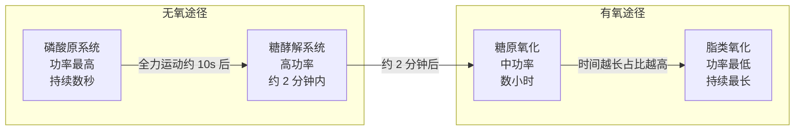

# 供能系统

## 定义

人体的直接供能物质是**三磷酸腺苷（ATP）**，但肌肉内 ATP 的储存总量只够维持几次有力的肌肉收缩，因此必须由不同代谢途径不断再合成 ATP。共有四条途径（四种"供能系统"）：

| 系统 | 是否需氧 | 功率 | 可维持时间 |
|---|---|---|---|
| 磷酸原系统（ATP-PCr） | 无氧 | 最高 | 数秒 |
| 糖酵解系统 | 无氧 | 高 | 约 2 分钟 |
| 糖原氧化 | 有氧 | 中 | 数小时 |
| 脂类氧化 | 有氧 | 最低 | 最长 |

前两种为无氧途径，后两种为有氧途径。由于 ATP 储量极少，**任何时候：用于运动的 ATP 总量 = 各途径合成 ATP 量的总和**——各系统同时开工，只是占比不同。

## 要点

- **按全力运动时间看主力切换**：时间越短，高功率系统占比越大；时间越长，有氧系统（尤其是脂类氧化）占比越大。
- **项目差异**：800m、1500m 主要由糖酵解系统和糖原氧化供能，占比约 **5:5** 和 **4:6**；5000m 几乎全由有氧代谢供能；马拉松中糖原氧化与脂类供能各占一半，且随时间增加脂类占比不断提高。
- **中距离项目的特殊性**：800m、1500m 属于"2～6 分钟完成"的中距离项目，**有氧、无氧两条途径都必须通过训练提高最大能量输出速率**——这直接决定了这类运动员的训练必须同时容纳两类刺激。
- **PCr 的恢复**：一次力竭冲刺后，磷酸肌酸（PCr）完全恢复需要 **3～5 分钟**（半时反应约 30 秒）；间歇训练中随组数增加，恢复时间还会延长到 4～5 分钟。这是间歇课"组间歇 3～4 分钟"的生理依据。
- **训练的代谢适应**：耐力训练使运动肌肉糖原储量增加（通常增加 40%～60%，可多达 100% 以上），并出现肌纤维 **Ⅱx → ⅡA 型转变**（理论上募集Ⅱ型纤维时产乳酸更少）。

## 出处

- 《高水平运动训练的生理学基础》第 2 章（运动表现的生物化学基础）：四条 ATP 合成途径、PCr 恢复时间、乳酸阈与代谢适应
- 第 6 章 表 6-1（中距离项目的界定与双途径依赖）、供能占比随全力运动时间的变化
- 第 9 章（400m 约 80% 能量来自无氧系统的例证）

## 相关

- 词条：[乳酸阈值](/concepts/乳酸阈值)、[最大摄氧量](/concepts/最大摄氧量)
- 文章：[中长跑周期化训练的生理学原理](/articles/01-周期化训练的生理学原理)（基础知识 1、2）
